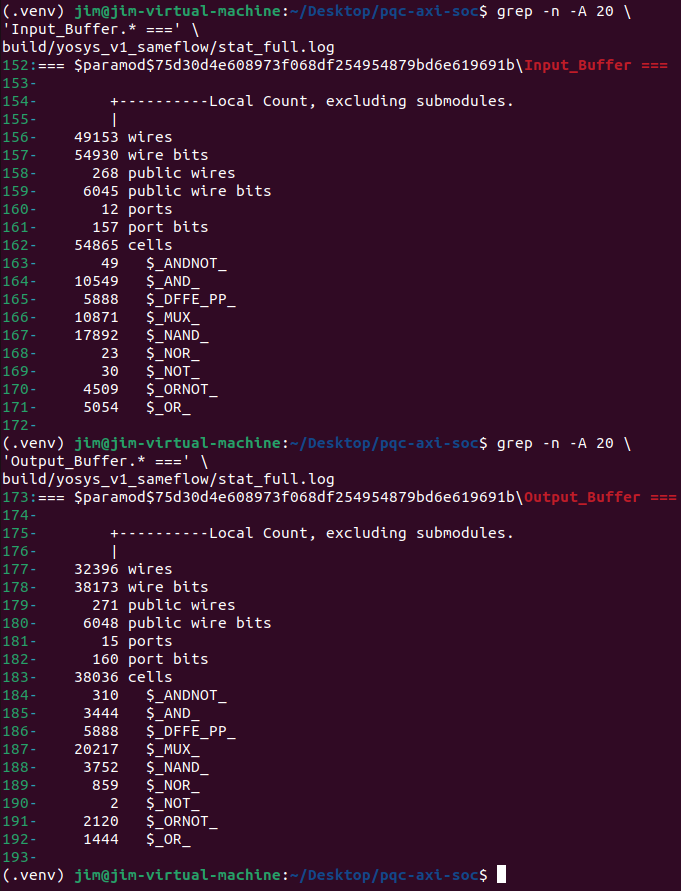
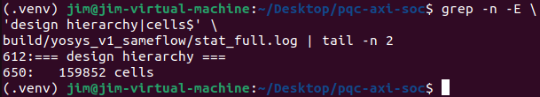
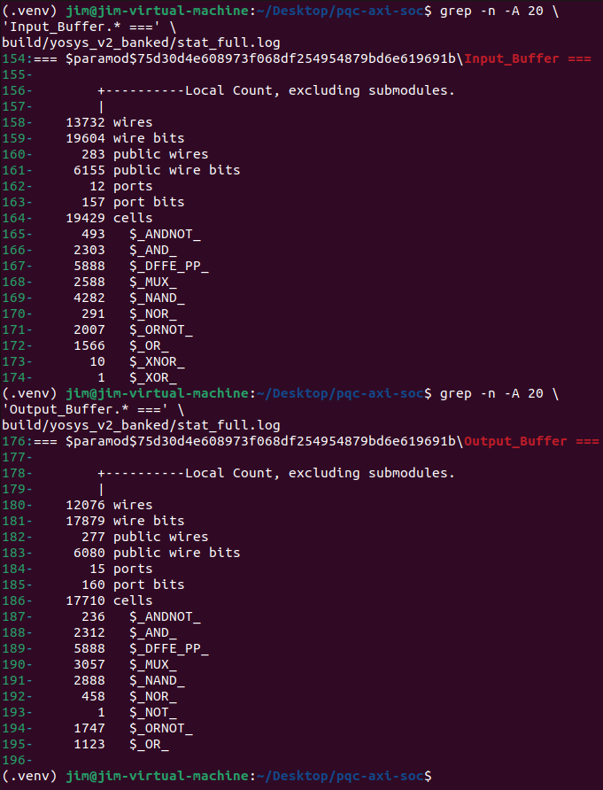
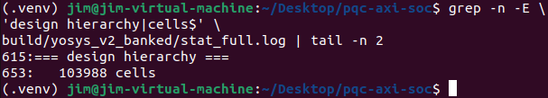

# PQC AXI SoC

An AXI-integrated post-quantum cryptography accelerator project built around an NTT/INTT hardware core.

The long-term goal is to provide a shared SoC/AXI integration framework with compile-time variants for **ML-DSA (Dilithium)** and **ML-KEM (Kyber)** NTT/INTT accelerators. The current implementation has completed the **Dilithium variant** through functional verification, architecture optimization, and RTL-to-GDS implementation. Kyber integration is the next implementation milestone.

The project focuses on SoC-style integration, self-checking RTL verification, ASIC implementation, and PPA design-space exploration. The original thesis NTT/INTT core is kept private; the public repository contains the AXI/control infrastructure, verification support, public implementation configuration, and summarized results.

## Current Status

- Dilithium NTT/INTT accelerator integrated with AXI4-Lite control and AXI4 data movement
- Self-checking RTL verification completed for the integrated Dilithium design
- V2 banked-buffer architecture implemented and verified
- Complete Yosys + OpenROAD RTL-to-GDS flow completed on Nangate45
- Clock-period characterization completed: **540.54 MHz timing-clean**, while **555.56 MHz fails setup timing**
- 500 MHz physical-design exploration completed through an **80% timing-clean high-density point**; the 85% stress point fails setup timing
- Kyber / ML-KEM integration is planned as the next major milestone

## Architecture

The public design includes:

- AXI4-Lite control/status registers
- AXI4 burst read loader
- AXI4 burst write engine
- Accelerator controller
- Input/output coefficient buffers
- Top-level AXI/accelerator integration

The current private Dilithium NTT/INTT accelerator processes four 23-bit coefficients per cycle and is connected through a private adapter.

The planned Kyber variant will reuse the shared AXI/control infrastructure while adapting coefficient width, packing/order behavior, buffering, and the private core adapter for the 12-bit ML-KEM data path.

## Verification

The integrated Dilithium design was verified with self-checking RTL tests covering:

- NTT and INTT golden-vector checking
- NTT → INTT round-trip checking
- AXI backpressure
- Protocol stability during stalls
- Six consecutive accelerator transactions without a global reset

## V1 ASIC Baseline

V1 is intentionally used as a conservative reference implementation rather than an aggressively PPA-optimized design.

**Technology:** Nangate45  
**Clock constraint:** 10.0 ns / 100 MHz  
**Flow:** Yosys + OpenROAD Flow Scripts

| Metric | V1 Baseline |
|---|---:|
| Generic cells | 159,852 |
| Nangate45 mapped area | 269,731 um² |
| Core area | 897,281.84 um² |
| Final design area | 274,408 um² |
| Final utilization | 31% |
| Setup worst slack | +6.18018 ns |
| Hold worst slack | +0.0566224 ns |
| Setup / Hold TNS | 0 / 0 |
| Clock skew | ~0.0525 ns |
| Routed wirelength | 2,079,691 um |
| Via count | 886,097 |
| Detailed-route violations | 0 |
| Antenna violations | 0 |
| Final GDS | Generated locally |

The complete V1 flow reached:

**RTL → Synthesis → Floorplan → Placement → CTS → Routing → RC Extraction → Final GDS**

## Bottleneck Analysis

Generic synthesis showed that the original monolithic multi-port coefficient buffers dominate the SoC-side logic cost.

To provide a fair V1/V2 comparison, V1 was re-synthesized using the same Yosys version, synthesis script, and reporting method used for V2.

### V1 Generic Cell Breakdown

The following breakdown is derived from the controlled Yosys synthesis results.  
Private thesis-related modules are aggregated into `Private NTT/INTT Acc` to avoid exposing the internal accelerator hierarchy.

| Module | Generic Cells | Share |
|---|---:|---:|
| Private NTT/INTT Acc | 65,928 | 41.24% |
| Input Buffer | 54,865 | 34.32% |
| Output Buffer | 38,036 | 23.79% |
| AXI Read Loader | 321 | 0.20% |
| AXI Write Writer | 222 | 0.14% |
| NTT Acc Control Top | 480 | 0.30% |
| **Total** | **159,852** | **100.00%** |

**Input + Output Buffers: 92,901 generic cells (58.12% of the full design).**

The input and output buffers therefore form the largest logic-cost component in V1, motivating the banked-buffer redesign in V2.

### V1 Yosys Results

V1 input/output buffer synthesis statistics:

Full-design generic cell count:

## V2 Banked Buffer Architecture

V2 replaces the original monolithic multi-port coefficient buffers with a banked storage architecture.

The redesign preserves the same logical coefficient storage capacity while reducing the multiplexing and routing logic required to support the accelerator access patterns.

The complete V2 functional regression passed:

- Input Buffer standalone verification: 516 checks, 0 errors
- Output Buffer standalone verification: 260 checks, 0 errors
- Full AXI + real Dilithium end-to-end verification: 768 checks, 0 errors
- Randomized AXI backpressure regression: 781 checks, 0 errors
- Six continuous multi-transaction regression: 2,425 checks, 0 errors

### V2 Generic Cell Breakdown

The following results use the same Yosys version, synthesis script, and reporting method as the controlled V1 synthesis.

| Module | Generic Cells | Share |
|---|---:|---:|
| Private NTT/INTT Acc | 65,826 | 63.30% |
| Input Buffer | 19,429 | 18.68% |
| Output Buffer | 17,710 | 17.03% |
| AXI Read Loader | 321 | 0.31% |
| AXI Write Writer | 222 | 0.21% |
| NTT Acc Control Top | 480 | 0.46% |
| **Total** | **103,988** | **100.00%** |

**Input + Output Buffers: 37,139 generic cells (35.71% of the full design).**

The storage capacity remains unchanged. Both V2 buffers still contain 5,888 storage flip-flops, corresponding to the original 256 × 23-bit coefficient capacity.

The reduction therefore comes primarily from the banked architecture reducing multi-port multiplexing and steering logic rather than from reducing the amount of stored data.

### V2 Yosys Results

V2 banked input/output buffer synthesis statistics:

Full-design generic cell count:

## Controlled V1 vs V2 Generic Synthesis Comparison

Both versions were synthesized using the same Yosys version, synthesis script, and reporting method.

| Metric | V1 | V2 Banked | Reduction |
|---|---:|---:|---:|
| Input Buffer Cells | 54,865 | 19,429 | **64.59%** |
| Input Buffer MUXes | 10,871 | 2,588 | **76.19%** |
| Output Buffer Cells | 38,036 | 17,710 | **53.44%** |
| Output Buffer MUXes | 20,217 | 3,057 | **84.88%** |
| Combined Buffer Cells | 92,901 | 37,139 | **60.02%** |
| Full Design Cells | 159,852 | 103,988 | **34.95%** |

The banked-buffer redesign reduces the generic logic cost of the two coefficient buffers by **60.02%**, while the complete design is reduced by **34.95%**.

The largest reductions occur in the multiplexing logic:

- Input Buffer MUX count: 10,871 → 2,588
- Output Buffer MUX count: 20,217 → 3,057

This confirms that the original bottleneck was primarily caused by the large multiplexing networks required by the monolithic multi-port buffer structures.

## Controlled V1 vs V2 Physical Comparison

V2 was implemented using the same controlled physical-design conditions as V1:

- Nangate45 standard-cell platform
- 10 ns clock period
- 100 MHz target frequency
- 30% core-utilization target
- 0.60 placement density
- Same OpenROAD implementation flow

| Metric | V1 Baseline | V2 Banked | Change |
|---|---:|---:|---:|
| Generic Cells | 159,852 | 103,988 | **-34.95%** |
| Nangate45 Mapped Area | 269,731 um² | 248,113.894 um² | **-8.01%** |
| Final Design Area | 274,408 um² | 253,512 um² | **-7.61%** |
| Final Utilization | 31% | 31% | Same |
| Routed Wirelength | 2,079,691 um | 1,723,531 um | **-17.13%** |
| Via Count | 886,097 | 760,944 | **-14.12%** |
| Setup Worst Slack | +6.18018 ns | +6.00561 ns | -0.17457 ns |
| Hold Worst Slack | +0.0566224 ns | +0.0513977 ns | -0.00522 ns |
| Setup / Hold TNS | 0 / 0 | 0 / 0 | PASS |
| Clock Skew | ~0.0525 ns | ~0.0578 ns | Slightly higher |
| Detailed-route Violations | 0 | 0 | PASS |
| Antenna Violations | 0 | 0 | PASS |
| Reported Power | 35.7 mW | 34.6 mW | **-3.08%** |
| Final GDS | Generated locally | Generated locally | PASS |

At the same 100 MHz implementation target, V2 achieves:

- **7.61% lower final design area**
- **17.13% lower routed wirelength**
- **14.12% fewer vias**
- **3.08% lower reported power**

while maintaining zero setup/hold TNS, zero detailed-route violations, and zero antenna violations.

## V2 Frequency Characterization

Clock-period characterization was performed with the RTL and physical-flow settings held fixed apart from the clock constraint.

| Clock Period | Frequency | Setup WNS | Hold WNS | Status |
|---:|---:|---:|---:|---|
| 2.50 ns | 400.00 MHz | +0.382649 ns | +0.036560 ns | PASS |
| 2.00 ns | 500.00 MHz | +0.044196 ns | +0.053103 ns | PASS |
| 1.95 ns | 512.82 MHz | +0.057708 ns | +0.052375 ns | PASS |
| 1.90 ns | 526.32 MHz | +0.049422 ns | +0.048744 ns | PASS |
| **1.85 ns** | **540.54 MHz** | **+0.005534 ns** | **+0.042779 ns** | **PASS** |
| 1.80 ns | 555.56 MHz | -0.013109 ns | +0.045149 ns | FAIL |
| 1.70 ns | 588.24 MHz | -0.099755 ns | +0.043240 ns | FAIL |

The **maximum timing-clean frequency observed in the characterized OpenROAD/Nangate45 flow is 540.54 MHz** at a 1.85 ns clock period.

The nearest tested higher-frequency point, 555.56 MHz at 1.80 ns, fails setup timing. This value is therefore reported as an implementation-flow characterization result rather than a measured silicon Fmax.

## V2 500 MHz Physical-Design Exploration

A 2.0 ns / 500 MHz operating point was selected for physical-design exploration because it provides useful performance while retaining timing margin for floorplan-density trade-offs.

The 30%-60% points form a controlled core-utilization sweep with placement density fixed at 0.60. The 70%-85% points are high-density candidates where placement density is increased together with core utilization; they should therefore be interpreted as implementation candidates rather than a single-variable controlled sweep.

| Core Util. | Place Density | Core Area | Final Design Area | Setup WNS | Wirelength | Reported Power | Status |
|---:|---:|---:|---:|---:|---:|---:|---|
| 30% | 0.60 | 826,053.690 um² | 253,962 um² | +0.044196 ns | 1,735,654 um | 156 mW | PASS |
| 40% | 0.60 | 618,392.544 um² | 253,584 um² | +0.078253 ns | 1,703,904 um | 155 mW | PASS |
| 50% | 0.60 | 495,003.124 um² | 253,153 um² | +0.070032 ns | 1,721,619 um | 155 mW | PASS |
| 60% | 0.60 | 412,265.952 um² | 252,891 um² | +0.136552 ns | 1,652,864 um | 154 mW | PASS |
| 70% | 0.70 | 353,239.488 um² | 252,374 um² | **+0.175961 ns** | 1,580,923 um | 152 mW | PASS |
| **80%** | **0.80** | **309,413.860 um²** | **251,856 um²** | **+0.068050 ns** | **1,502,844 um** | **150 mW** | **PASS** |
| 85% | 0.85 | 291,151.630 um² | 251,726 um² | -0.003185 ns | 1,493,338 um | 150 mW | FAIL |

The 80% / 0.80 implementation is the **highest-density timing-clean point found in the sweep**. Relative to the 30% / 0.60 500 MHz reference, it achieves:

- **62.54% smaller core footprint**
- **13.41% lower routed wirelength**
- **3.85% lower reported power**
- **0.83% lower final design-cell area**

while maintaining positive setup/hold slack, zero detailed-route violations, and zero antenna violations.

The 70% / 0.70 point is retained as a more timing-balanced implementation candidate because it provides substantially larger setup margin (+0.175961 ns) while still reducing core footprint, wirelength, and reported power compared with the 30% reference.

The 85% / 0.85 stress point is DRC-clean but fails setup timing by 3.185 ps, identifying the density boundary for this 500 MHz exploration.

`Core Area` and `Final Design Area` describe different quantities: core area is the physical placement footprint, whereas final design area is the summed area of placed design instances/cells. Increasing utilization primarily compresses the former; it does not remove the RTL logic itself.

Reported power values are OpenROAD-flow estimates and are used primarily for relative comparison under the same analysis assumptions. They are not silicon measurements.

## Repository Notes

The following are intentionally kept private:

- Thesis NTT/INTT RTL
- Private integration adapters and testbenches
- Golden-vector files
- Synthesized private netlists
- ODB / DEF / GDS / SPEF / SDF artifacts
- Raw reports containing private hierarchy information

Public results are limited to sanitized summaries, reproducibility-oriented public configuration, and non-sensitive implementation metrics.

`asic/orfs/v1_baseline/Config.Public.mk` documents the V1 OpenROAD configuration, but it is not standalone runnable without a user-supplied accelerator core and integration wrapper.

## Tools

- Verilog
- Verilator
- Yosys
- OpenROAD Flow Scripts
- Nangate45
- Git
